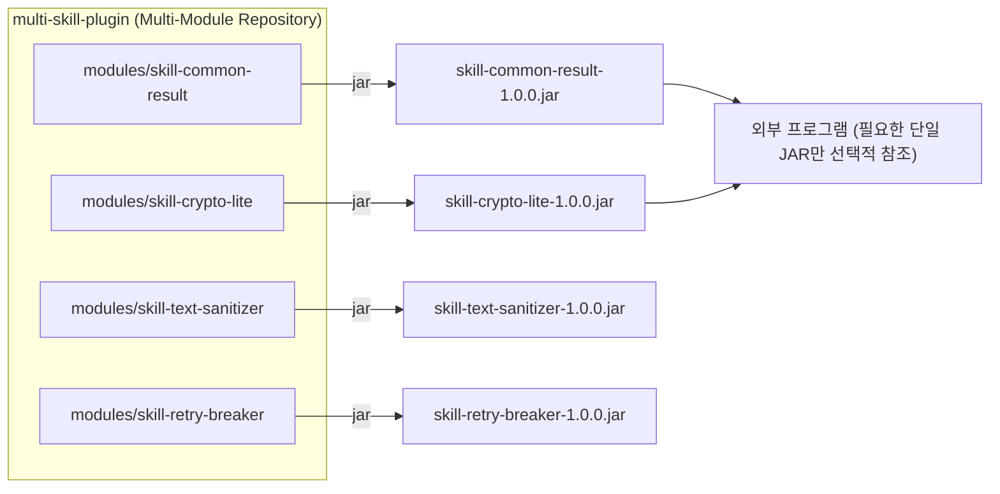

# 🧩 multi-skill-plugin

> **단일 기술(Single-Purpose Skill)을 독립 모듈(`modules/*`) 및 개별 `.jar` 형태로 제공하여, 다른 프로그램에서 복잡한 프레임워크 의존성 없이 간단하게 가져다 쓸 수 있는 경량 기능 모음집**

---

## 1. 🎯 프로젝트 목표 및 아키텍처

- **One Skill = One Module = One `.jar`**: 각 기술은 `modules/<skill-name>` 하위의 독립 모듈로 개발되며, 개별 `.jar` 아티팩트로 패키징됩니다.
- **Zero / Minimal Dependency**: 무거운 프레임워크에 종속되지 않는 순수 Java 21 기반 경량 구현을 지향하여 타 프로그램에서 충돌 없이 즉시 임포트할 수 있습니다.
- **Wiki-First Thinking**: 모든 기술 설계와 모듈 카탈로그, 애자일 일정 관리는 중앙 RAG 볼트(`D:\obsidian-storage\project-rag\multi-skill-plugin\`)의 정본 위키를 기반으로 먼저 사고(Think)하고 구현합니다.



---

## 2. 📦 모듈 빌드 및 개별 JAR 추출 방법

### 특정 모듈 단독 `.jar` 생성
```powershell
.\gradlew.bat :modules:<skill-name>:jar
```
생성된 JAR 경로: `modules/<skill-name>/build/libs/<skill-name>-1.0.0.jar`

### 로컬 Maven 저장소(`~/.m2`) 배포 후 타 프로젝트에서 참조
```powershell
.\gradlew.bat :modules:<skill-name>:publishToMavenLocal
```
외부 프로그램의 `build.gradle`:
```groovy
repositories {
    mavenLocal()
}
dependencies {
    implementation 'com.msp:<skill-name>:1.0.0'
}
```

---

## 3. 🌿 Git Flow 브랜치 전략

본 저장소는 계층형 Git Flow 전략을 사용하여 각 기술 모듈을 안전하게 개발·검증합니다:

1. **`main`**: 최종 검증이 완료된 릴리즈 브랜치
2. **`feature/<기능명>`**: 단일 기술 모듈 또는 기능 단위로 `main`에서 분기하는 개발 브랜치
3. **`sub/<기능명>/<수정사항>`**: 각 기능 개발 중 발생하는 세부 구현, 수정 사항, 버그 패치, 리팩토링을 구분하여 작업하는 서브 브랜치 (`feature/<기능명>`으로 1차 병합 후 최종본을 `main`에 병합)

---

## 4. 📚 102개 단일 기술 모듈 사용법 및 테스트 검증 명세서 (Documentation)

모든 102개 모듈은 **Zero 3rd-party Runtime Dependencies(순수 Java 21)** 기반 독립 Standalone JAR로 제공되며, 입력 데이터와 예상 결과 데이터를 1:1 매칭 검증하는 종합 단위 테스트와 사용법이 문서화되어 있습니다:

- **[전체 마스터 가이드 인덱스](wiki/02-modules/00-test-verification-and-usage-master.md)**: 102개 전 모듈 실무 사용법 & 입력 $\rightarrow$ 예상 결과 데이터 매칭표
- **도메인별 상세 명세 및 테스트 데이터 매칭표**:
  1. [Base & Core 실무 22선 가이드](wiki/02-modules/domain-00-base-core-guide.md): 테이블 복사기, Result, Snowflake, AES/RSA, JWT, 패스워드해시, 처리율제한, 서킷브레이커, 네임드락, LRU캐시, XSS정제, SQL빌더, JsonPath, Diff/Patch, 템플릿엔진, CSV스트리머, 파일감지, Cron, HTTP, 웹훅, 타이머, 이벤트버스
  2. [Domain 1: 검증 & 타입 변환 가이드](wiki/02-modules/domain-01-validation-type-guide.md): Validator, TypeConverter, 휴대폰/전화번호, Luhn 신용카드, 한글 조사, 사업자번호, 주민번호, ISBN, URL빌더, SemVer 2.0.0
  3. [Domain 2: 텍스트 처리 & 문자열 가이드](wiki/02-modules/domain-02-text-processing-guide.md): CaseConverter, Levenshtein/Jaro 유사도, 한글 초성 검색, 말줄임, 콘솔 표 포맷터, 슬러그 생성기, LCS Diff, 모스 부호, 한글 금액 음독, 플레이스홀더 치환기
  4. [Domain 3: 데이터 포맷 & 직렬화 가이드](wiki/02-modules/domain-03-data-formats-guide.md): YAML 파서, XML 트리 빌더, 프로퍼티 로더, Base64/Hex 코덱, INI 파서, 금융 고정길이 전문, 바이너리 바이트 패커, SQL 포맷터, HTML 태그 스트리퍼, JSON 미니파이어
  5. [Domain 4: 동시성 제어 & 플로우 가이드](wiki/02-modules/domain-04-concurrency-flow-guide.md): 디바운스/쓰로틀, 마이크로 배치 버퍼, Fluent 프라미스, SingleFlight 중복 방어, 스레드 풀 모니터링, 분할 카운터, Fan-out/Fan-in, 우선순위 큐, 그레이스풀 셧다운, 가상 스레드 러너
  6. [Domain 5: 수학, 통계 & 알고리즘 가이드](wiki/02-modules/domain-05-math-algorithms-guide.md): 백분위수(P50~P99), 가중치 무작위 추첨, Haversine 위경도 거리, Smooth 가중 라운드로빈, Murmur3 블룸 필터, 가상 노드 해시 링, 슬라이딩 타임 카운터, HyperLogLog, 2D 행렬 연산, 데이터/시간 단위 환산기
  7. [Domain 6: 시스템, OS & 파일 유틸 가이드](wiki/02-modules/domain-06-system-file-guide.md): ZIP 압축 및 ZipSlip 방어, JVM/OS 진단, 스트리밍 SHA-256 체크섬, AutoCloseable 임시 파일, 파일 분할/병합, OS 명령어 비동기 실행, 매직 바이트 MIME 감지, 디렉터리 청소, Grep 탐색, 경로 정규화
  8. [Domain 7: 날짜, 시간 & 캘린더 가이드](wiki/02-modules/domain-07-date-time-guide.md): 한국 법정/대체공휴일 계산기, N영업일 계산기, SNS형 상대 시간 포맷터, 다중 포맷 일시 파서, 글로벌 타임존/서머타임 변환기, Cron 자연어 설명, 일자 범위 스트림, D-Day 및 만/연 나이, 회계연도/분기, 1900~2100년 양음력 변환기
  9. [Domain 8: 관측성, 로깅 & 진단 가이드](wiki/02-modules/domain-08-observability-testing-guide.md): W3C/B3 분산 추적 ID 전파기, 감사 로그 포맷터 & 민감정보 마스킹, 가짜 목 데이터 생성기, 슬로우 쿼리 감지기, 예외 루트 원인 분석기, 복합 헬스체크 리포터, 핫 힙덤프(.hprof), 구조화 JSON 로그 포맷터, 계층형 호출 트리 프로파일러, 메모리 누수 감지기

---

## 5. 📋 애자일 (칸반 / 스크럼) 프로젝트 관리

일정 관리 및 보고서는 **백로그(Backlog), TODO, 칸반(Kanban), 스크럼(Scrum)** 애자일 방식으로 운영됩니다.
상세 현황은 외부 정본 위키(`D:\obsidian-storage\project-rag\multi-skill-plugin\`, 로컬 `wiki/` 정션)의 아래 문서에서 관리됩니다:

- `05-agile-scrum/product-backlog.md`: 프로덕트 백로그 (Epic & Story Point, 총 105개 PBI / 328 SP 100% 완료)
- `05-agile-scrum/kanban-board.md`: 실시간 칸반 보드 (`102개 전 모듈 Done 완료`)
- `05-agile-scrum/sprint-scrum-log.md`: 스프린트 계획 및 데일리 스크럼 기록
- `06-reports/final-project-completion-report.md`: 102개 단일 모듈 전수 개발 완주 최종 보고서
