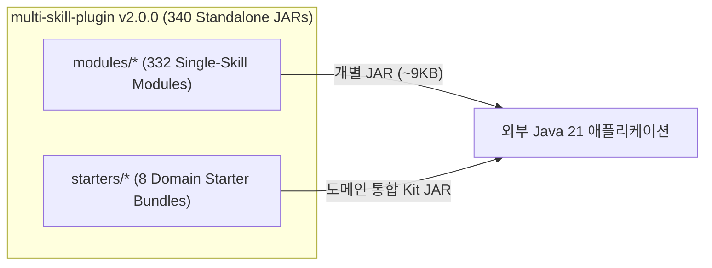

# 🧩 multi-skill-plugin (`v2.0.0`)

[](https://github.com/rlaguswls13/multi-skill-plugin/actions/workflows/ci.yml)
[](https://github.com/rlaguswls13/multi-skill-plugin/releases)
[](https://adoptium.net/)
[-brightgreen.svg)](#1-프로젝트-목표-및-아키텍처)

> **단일 기술(Single-Purpose Skill)을 독립 모듈(`modules/*`) 및 개별 `.jar` 형태로 제공하여, 다른 Java 프로그램에서 복잡한 프레임워크 의존성 없이 즉시 가져다 쓸 수 있는 순수 Java 21 경량 백엔드 기능 모음집**

- **누적 모듈**: **332개 단일 기술 모듈 (`modules/*`)** + **8대 도메인 Starter 번들 (`starters/*`)** = **총 340개 Standalone JAR**
- **런타임 외부 의존성**: **Zero (0개)** — 순수 Java 21 표준 라이브러리(`java.*`, `javax.*`)만 사용
- **평균 JAR 용량**: **~9 KB** (극단적 초경량 패키징)
- **품질 검증**: Windows + Linux (`ubuntu-latest`) GitHub Actions CI 전수 JUnit 5 단위 테스트 100% Pass

---

## 1. 🎯 프로젝트 목표 및 아키텍처

- **One Skill = One Module = One `.jar`**: 각 기술은 `modules/<skill-name>` 하위의 독립 모듈로 개발되며, 개별 `.jar` 아티팩트로 패키징됩니다.
- **Zero 3rd-Party Runtime Dependency**: 외부 라이브러리 충돌이나 취약점(CVE) 전파 없이 타 프로젝트 클래스패스에 단독으로 추가해 즉시 사용할 수 있습니다.
- **Domain Starter Bundles (`starters/*`)**: 자주 함께 쓰이는 핵심 모듈들을 도메인별 통합 파사드(`*Kit`)와 함께 8대 스타터 번들로 제공합니다.
- **Wiki-First Thinking**: 모든 기술 설계와 모듈 카탈로그, 애자일 일정 관리는 정본 위키(SSOT)를 먼저 설계·갱신한 뒤 구현합니다.



---

## 2. 📦 설치 및 사용 방법 (Gradle / JitPack / Standalone JAR)

### 방법 A. JitPack 원격 Maven 저장소로 즉시 임포트 (권장)
```groovy
repositories {
    mavenCentral()
    maven { url 'https://jitpack.io' }
}

dependencies {
    // 1) 필요한 단일 기술 모듈만 선택 참조
    implementation 'com.github.rlaguswls13.multi-skill-plugin:skill-jwt-lite:v2.0.0'
    implementation 'com.github.rlaguswls13.multi-skill-plugin:skill-bloom-filter-lite:v2.0.0'

    // 2) 또는 도메인 통합 Starter 번들 참조
    implementation 'com.github.rlaguswls13.multi-skill-plugin:starter-security-auth:v2.0.0'
    implementation 'com.github.rlaguswls13.multi-skill-plugin:starter-http-network:v2.0.0'
}
```

### 방법 B. 로컬 빌드 및 개별 `.jar` 추출
```bash
# 특정 단일 모듈 JAR 빌드
./gradlew :modules:<skill-name>:jar
# 산출물: modules/<skill-name>/build/libs/<skill-name>-2.0.0.jar

# 전체 340개 모듈 & 스타터 테스트 및 JAR 일괄 빌드
./gradlew test jar

# 로컬 Maven 저장소(~/.m2) 배포
./gradlew :modules:<skill-name>:publishToMavenLocal
```

### 방법 C. GitHub Release 바이너리 다운로드
[Releases](https://github.com/rlaguswls13/multi-skill-plugin/releases) 페이지에서 `multi-skill-plugin-v2.0.0-standalone-jars.zip`을 받아 원하는 `.jar` 파일만 프로젝트 `libs/`에 복사해 사용할 수 있습니다.

---

## 3. 🧰 8대 도메인 통합 Starter 번들 (`starters/*`)

| Starter 번들 (`artifactId`) | 통합 파사드 (`*Kit`) | 주요 포함 기술 모듈 |
| :--- | :--- | :--- |
| **`starter-security-auth`** | `SecurityAuthKit` | AES-256-GCM 암호화, PBKDF2 패스워드 해싱, JWT 발급/검증, XSS/PII 마스킹 |
| **`starter-resilience-concurrency`** | `ResilienceConcurrencyKit` | 처리율 제한, 재시도/서킷브레이커, 키 락커, LRU 캐시, SingleFlight, 가상스레드 |
| **`starter-date-time`** | `DateTimeKit` | 한국 법정/대체공휴일, 영업일, 양음력(1900~2100), 타임존, Cron 자연어, D-Day |
| **`starter-observability`** | `ObservabilityKit` | W3C/B3 분산추적, 감사로그, 슬로우쿼리, 예외분석, 헬스체크, 프로파일러, 누수탐지 |
| **`starter-http-network`** *(New v2.0)* | `HttpNetworkKit` | RFC 7807 Problem Details, CORS, ETag 조건부 평가, RFC 8288 Link 헤더, Bogon/SSRF 방어, CIDR |
| **`starter-sql-data`** *(New v2.0)* | `SqlDataKit` | 동적 SQL 빌더, 식별자 이스케이프, SQL Injection 탐지, Keyset Seek 페이징, 샤딩 라우터, JSON Path 조건절 |
| **`starter-probabilistic-algo`** *(New v2.0)* | `ProbabilisticAlgoKit` | Bloom Filter, HyperLogLog++, T-Digest 분위수, Count-Min Sketch, Roaring Bitmap, Consistent Hashing |
| **`starter-string-codec`** *(New v2.0)* | `StringCodecKit` | Aho-Corasick, KMP, Suffix Array/LCP, VarInt/LEB128, z-base-32, BER-TLV/ASN.1 코덱 |

---

## 4. 🗂️ 332개 단일 기술 모듈 도메인 총괄 (`modules/*`)

1. **보안 · 인증 · JWT / PKI / 암호화**: JWT Lite, JWK/JWKS/Thumbprint(RFC 7638), JWE(RFC 7516), JWS Detached(RFC 7515), PASETO v3.local, DPoP, COSE Key, X.509/CRL/OCSP(RFC 6960), AES-256-GCM, PBKDF2, NIST 엔트로피, TOTP(RFC 6238), K-익명성, `@Mask`
2. **HTTP · 웹 프로토콜 · IP / DNS / Geo**: RFC 7807 Problem Details, RFC 8941 Structured Fields, RFC 8288 Web Linking, RFC 7616 Digest Auth, RFC 6265 CookieJar, CORS, ETag, HPACK, SSE 클라이언트/이미터, CIDR/Radix LPM 라우터, BGP 프리픽스 집약, Bogon/SSRF 분류기, DNS Wire 파서, Geohash/QuadKey/Encoded Polyline/Geofence
3. **동시성 · 회복탄력성 · 트래픽 제어**: Token/Leaky/Sliding/GCRA/Distributed/Adaptive(TCP Vegas) Rate Limiter, Circuit Breaker, Bulkhead, Hedged Request, DLQ, SingleFlight, Striped ReadWriteLock, Java 21 Virtual Thread Runner, Fan-out/Fan-in, Priority Queue
4. **확률적 자료구조 · 스케치 · 비트맵**: Bloom Filter 8종(Standard/Counting/Scalable/Partitioned/Cuckoo/Quotient), HyperLogLog++, T-Digest, Count-Min Sketch, SimHash, MinHash-LSH, Roaring Bitmap, Ketama Consistent Hash Ring
5. **SQL · 데이터베이스 · 마이그레이션**: 동적 SQL 빌더, Lexer/AST Visitor, Named Binder, Injection 탐지기, Window/CTE/Upsert/JSON Path 빌더, Keyset Seek 페이징, Sharding 라우터, DDL 생성기, Excel/CSV→JDBC 배치 이관기
6. **문자열 · 검색 알고리즘 · 한글 특화**: Aho-Corasick, KMP, Boyer-Moore-Horspool, Rabin-Karp 롤링 해시, Suffix Array & Kasai LCP, Levenshtein/Jaro-Winkler, Inverted Index, BM25, ReDoS 가드, 한글 초성/조사/금액음독/로마자
7. **바이너리 코덱 · JSON · Diff · 포맷**: VarInt/LEB128, MsgPack, CBOR, BER-TLV/ASN.1, Bencode, Base91/62/58/32/z-base-32, JSON Path/Schema/Patch(RFC 6902)/Flatten/Stream, Myers LCS/3-Way Merge, POI-Free `.xlsx` 리더, YAML/XML/INI/Fixed-Length
8. **Cron · 스케줄링 · 날짜/시간 · 캘린더**: Cron 파서/자연어 변환/지터/중복방지/DAG/SLA/RRULE(RFC 5545)/Blackout 윈도우/Rate-Smoothed 배치 스케줄러, 한국 법정공휴일·양음력(1900~2100)·영업일·회계연도
9. **OS 프로세스 · 파일 · 압축**: 파이프라인/PTY/cgroups/PID Lock/Graceful Tree Killer/리소스 쿼터 워치독/CLI 토크나이저, ZIP(ZipSlip 방어)/TAR/GZIP 스트리머, LRU 디스크 캐시
10. **관측성 · 진단 · 검증 · 수학**: W3C/B3 TraceId, 감사로그, NDJSON, p50~p99 메트릭, 호출 트리 프로파일러, 슬로우쿼리, 핫 힙덤프(`.hprof`), 누수 탐지기, Result/Try, Snowflake/ULID, SemVer, 통화 계산기, RPN 표현식, WCAG 2.1 컬러

---

## 5. 🌿 Git Flow 브랜치 전략 & CI/CD

- **3계층 Git Flow**: `main` ← `feature/<기능명>` ← `sub/<기능명>/<세부작업>` (`--no-ff` 병합)
- **GitHub Actions CI**: `.github/workflows/ci.yml` — `ubuntu-latest` + JDK 21 Temurin 환경에서 전 모듈 JUnit 5 테스트 및 Standalone JAR 패키징 자동 검증

---

## 6. 📋 변경 이력 (Changelog)

주요 릴리스 변경 내역은 [CHANGELOG.md](CHANGELOG.md)에서 확인할 수 있습니다.
