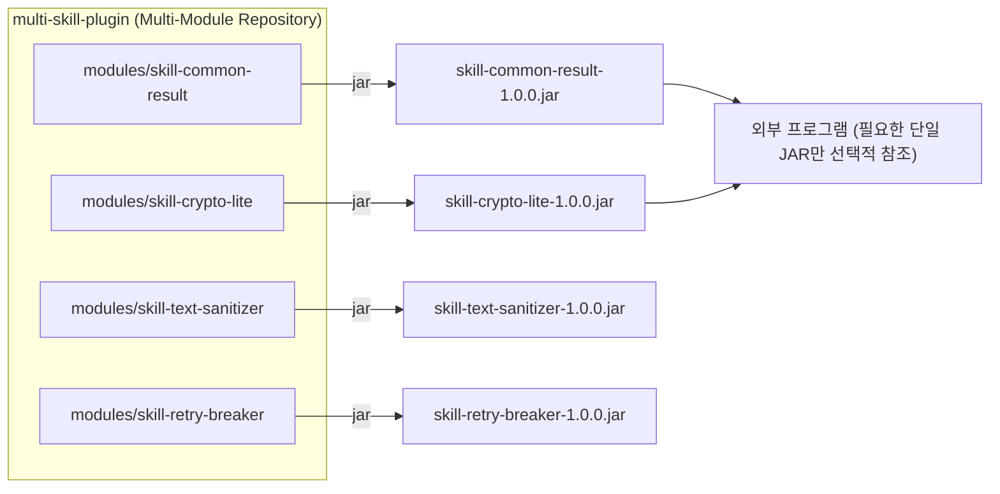

# 🧩 multi-skill-plugin

> **단일 기술(Single-Purpose Skill)을 독립 모듈(`modules/*`) 및 개별 `.jar` 형태로 제공하여, 다른 프로그램에서 복잡한 프레임워크 의존성 없이 간단하게 가져다 쓸 수 있는 경량 기능 모음집**

---

## 1. 🎯 프로젝트 목표 및 아키텍처

- **One Skill = One Module = One `.jar`**: 각 기술은 `modules/<skill-name>` 하위의 독립 모듈로 개발되며, 개별 `.jar` 아티팩트로 패키징됩니다.
- **Zero / Minimal Dependency**: 무거운 프레임워크에 종속되지 않는 순수 Java 21 기반 경량 구현을 지향하여 타 프로그램에서 충돌 없이 즉시 임포트할 수 있습니다.
- **Wiki-First Thinking**: 모든 기술 설계와 모듈 카탈로그, 애자일 일정 관리는 중앙 RAG 볼트(`D:\obsidian-storage\project-rag\multi-skill-plugin\`)의 정본 위키를 기반으로 먼저 사고(Think)하고 구현합니다.



---

## 2. 📦 모듈 빌드 및 개별 JAR 추출 방법

### 특정 모듈 단독 `.jar` 생성
```powershell
.\gradlew.bat :modules:<skill-name>:jar
```
생성된 JAR 경로: `modules/<skill-name>/build/libs/<skill-name>-1.0.0.jar`

### 로컬 Maven 저장소(`~/.m2`) 배포 후 타 프로젝트에서 참조
```powershell
.\gradlew.bat :modules:<skill-name>:publishToMavenLocal
```
외부 프로그램의 `build.gradle`:
```groovy
repositories {
    mavenLocal()
}
dependencies {
    implementation 'com.msp:<skill-name>:1.0.0'
}
```

---

## 3. 🌿 Git Flow 브랜치 전략

본 저장소는 계층형 Git Flow 전략을 사용하여 각 기술 모듈을 안전하게 개발·검증합니다:

1. **`main`**: 최종 검증이 완료된 릴리즈 브랜치
2. **`feature/<기능명>`**: 단일 기술 모듈 또는 기능 단위로 `main`에서 분기하는 개발 브랜치
3. **`sub/<기능명>/<수정사항>`**: 각 기능 개발 중 발생하는 세부 구현, 수정 사항, 버그 패치, 리팩토링을 구분하여 작업하는 서브 브랜치 (`feature/<기능명>`으로 1차 병합 후 최종본을 `main`에 병합)

---

## 4. 📋 애자일 (칸반 / 스크럼) 프로젝트 관리

일정 관리 및 보고서는 **백로그(Backlog), TODO, 칸반(Kanban), 스크럼(Scrum)** 애자일 방식으로 운영됩니다.
상세 현황은 외부 정본 위키(`D:\obsidian-storage\project-rag\multi-skill-plugin\`, 로컬 `wiki/` 정션)의 아래 문서에서 관리됩니다:

- `05-agile-scrum/product-backlog.md`: 프로덕트 백로그 (Epic & Story Point)
- `05-agile-scrum/kanban-board.md`: 실시간 칸반 보드 (`Backlog` → `TODO` → `In Progress` → `Review/QA` → `Done`)
- `05-agile-scrum/sprint-scrum-log.md`: 스프린트 계획 및 데일리 스크럼 기록
- `06-reports/sprint-01-report.md`: 스프린트 종합 보고서
